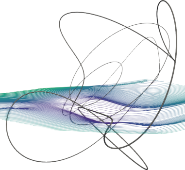
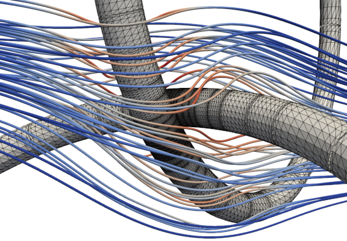
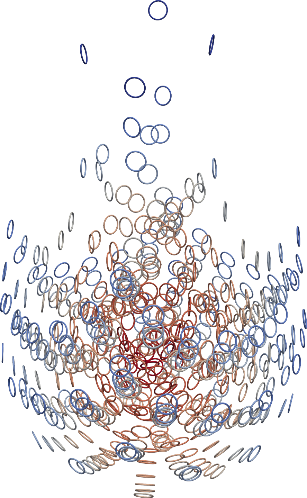

..
   Copyright (C) 2021-2026 The Simons Foundation, Inc. and the CSBQ authors (see NOTICE)
   Author: Dhairya Malhotra
   SPDX-License-Identifier: Apache-2.0

.. _csbq_documentation:

Convergent slender-body quadrature (CSBQ)
===========================================

.. image:: https://badgen.net/github/tag/dmalhotra/CSBQ
   :alt: Stable Version
   :target: https://github.com/dmalhotra/CSBQ/tags

.. image:: https://img.shields.io/github/v/release/dmalhotra/CSBQ?color=%233D9970
   :alt: Latest Release
   :target: https://github.com/dmalhotra/CSBQ/releases

.. image:: https://zenodo.org/badge/363025186.svg
   :alt: DOI
   :target: https://zenodo.org/doi/10.5281/zenodo.10456743

Principal author **Dhairya Malhotra**, with additional code by **Alex Barnett**.
This work was done at the Center for Computational Mathematics at the Flatiron Institute, NY, NY.

`CSBQ <https://github.com/dmalhotra/CSBQ>`_ is a high-performance parallel C++ implementation of a high-order
adaptive Nyström quadrature for the boundary integral equations arising
in 3D Laplace and Stokes Dirichlet and rigid mobility boundary-value problems
for closed loop filaments of arbitrarily small circular cross-section.
Its quadrature setup cost is independent of the slenderness parameter, being around 20000 unknowns/sec per core, at 6-digit accuracy, away from close-to-touching regions.
Close-to-touching geometries may be handled to close to machine accuracy using adaptivity.
Open-ended fibers with rounded ends are possible and will be added soon.

This repository also contains MATLAB codes implementing the classical
slender-body theory asymptotic approximation,
and solving its linear inverse problem as needed for a mobility solve.

It is research software; use at your own risk. The following figures show some of the capabilities of the code (see the publication below for details).

   Stokes flow solution around rigid slender fiber with aspect ratio :math:`10^3`, max error :math:`10^{-10}`.

   
   Stokes flow solution near close-to-touching rings, max error :math:`10^{-11}`.

   Sedimentation of 512 rings each of aspect ratio 20, timestepped to 7-digit accuracy on 160 cores.

Citing CSBQ
-----------

If you use CSBQ, or code derived from it, please cite the software and the paper below:

- D. Malhotra, A. Barnett, *CSBQ: Convergent slender-body quadrature*, https://github.com/dmalhotra/CSBQ, `doi:10.5281/zenodo.10456743 <https://doi.org/10.5281/zenodo.10456743>`__.
- D. Malhotra, A. Barnett, "Efficient convergent boundary integral methods for slender bodies," *Journal of Computational Physics* 503 (2024) 112855, `doi:10.1016/j.jcp.2024.112855 <https://doi.org/10.1016/j.jcp.2024.112855>`__.

.. raw:: html

   

   
BibTeX

.. code-block:: bibtex

   @software{csbq,
     author    = {Malhotra, Dhairya and Barnett, Alex},
     title     = {{CSBQ}: Convergent slender-body quadrature},
     url       = {https://github.com/dmalhotra/CSBQ},
     doi       = {10.5281/zenodo.10456743},
     version   = {2.0.0},
     year      = {2026}
   }

   @article{malhotra2024slender,
     author  = {Malhotra, Dhairya and Barnett, Alex},
     title   = {Efficient convergent boundary integral methods for slender bodies},
     journal = {Journal of Computational Physics},
     volume  = {503},
     pages   = {112855},
     year    = {2024},
     doi     = {10.1016/j.jcp.2024.112855}
   }

.. raw:: html

   

.. toctree::
   :maxdepth: 1
   :hidden:

   Introduction <self>
   getting-started
   tutorial/index

.. toctree::
   :caption: API Reference
   :maxdepth: 1
   :hidden:

   doxygen/index

